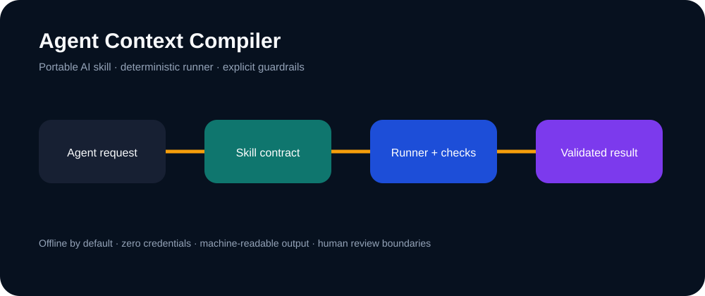

# Agent Context Compiler

[](LICENSE) [](https://github.com/qasimrazamalik-coder/agent-context-compiler)

> Agents waste tokens by loading context in discovery order instead of value order.

Provider-neutral AI skill for Claude Code, Codex, ChatGPT, Claude, Gemini, Grok and custom agent runtimes. It combines concise agent instructions with a deterministic Python execution path.

## Quick answer

**Agent Context Compiler** is an open-source, provider-neutral AI agent skill that compile large mixed-context inputs into a relevance-ranked, token-budgeted context packet with provenance and omission reasons. Use when an AI coding or research agent needs to select files, notes, logs, or retrieved passages before a task. It runs locally, requires no API key, and works with Claude Code, Codex, ChatGPT, Gemini, Grok, MCP-compatible agents, and custom runtimes.

## What it does

Compile large mixed-context inputs into a relevance-ranked, token-budgeted context packet with provenance and omission reasons. Use when an AI coding or research agent needs to select files, notes, logs, or retrieved passages before a task.

## Architecture

```text
User/Agent → SKILL.md → input contract → deterministic runner → validated JSON result
```

## Install

Copy `skill/` into your agent's skills directory, or reference `skill/SKILL.md` from an agent configuration. No API key or network access is required.

## Demo

```bash
python skill/scripts/run.py examples/input.json --mode context
pytest -q
```



## Compatibility

| Runtime | Method |
|---|---|
| Codex / ChatGPT | Install or reference `skill/` |
| Claude Code | Add `skill/SKILL.md` to project instructions or a command wrapper |
| Gemini / Grok | Supply `SKILL.md` as system/project context and expose the runner as a tool |
| MCP agents | Wrap the runner as a stdio tool with the documented JSON contract |

## Safety

See [SECURITY.md](SECURITY.md) and [docs/GUARDRAILS.md](docs/GUARDRAILS.md). The skill does not bypass access controls or transmit input data.

## Common questions

### What is Agent Context Compiler?

Compile large mixed-context inputs into a relevance-ranked, token-budgeted context packet with provenance and omission reasons. Use when an AI coding or research agent needs to select files, notes, logs, or retrieved passages before a task.

### Which AI tools can use it?

Claude Code, Codex, ChatGPT, Gemini, Grok, MCP-compatible agents, and custom agent runtimes can use the instructions and deterministic runner.

### Does it require an API key or cloud service?

No. The reference workflow runs locally with Python and uses no external dependency or network call.

### Is commercial use allowed?

Yes. The project is released under the permissive [MIT License](LICENSE), including commercial use, modification, and redistribution subject to the license notice.

### Where are the installation and safety instructions?

See [Installation](docs/INSTALLATION.md), [Guardrails](docs/GUARDRAILS.md), and [Security](SECURITY.md).

## Discovery keywords

agent, context, compiler, AI agent skill, agentic workflow, Claude Code skill, Codex skill, ChatGPT skill, Gemini skill, Grok skill, MCP, Python automation, open source AI tooling

## License

MIT © 2026 Qasim Raza Malik. See [LICENSE](LICENSE).
